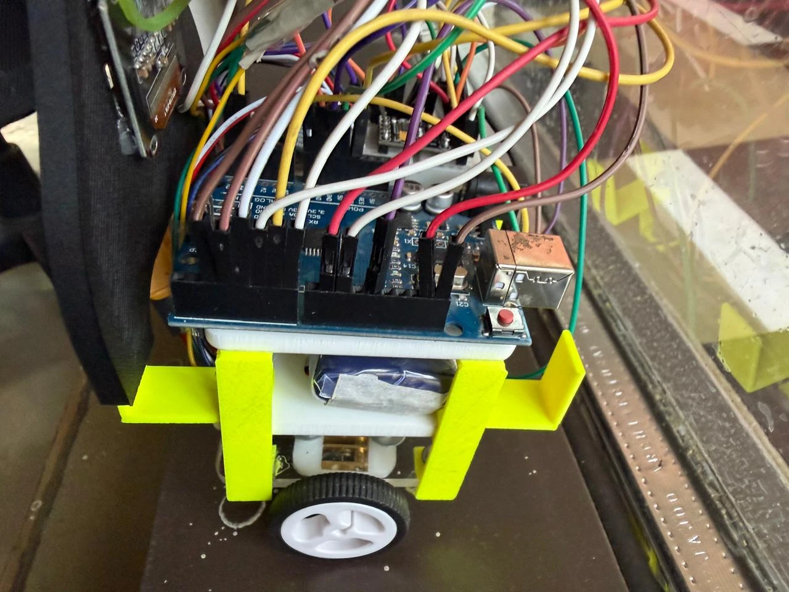
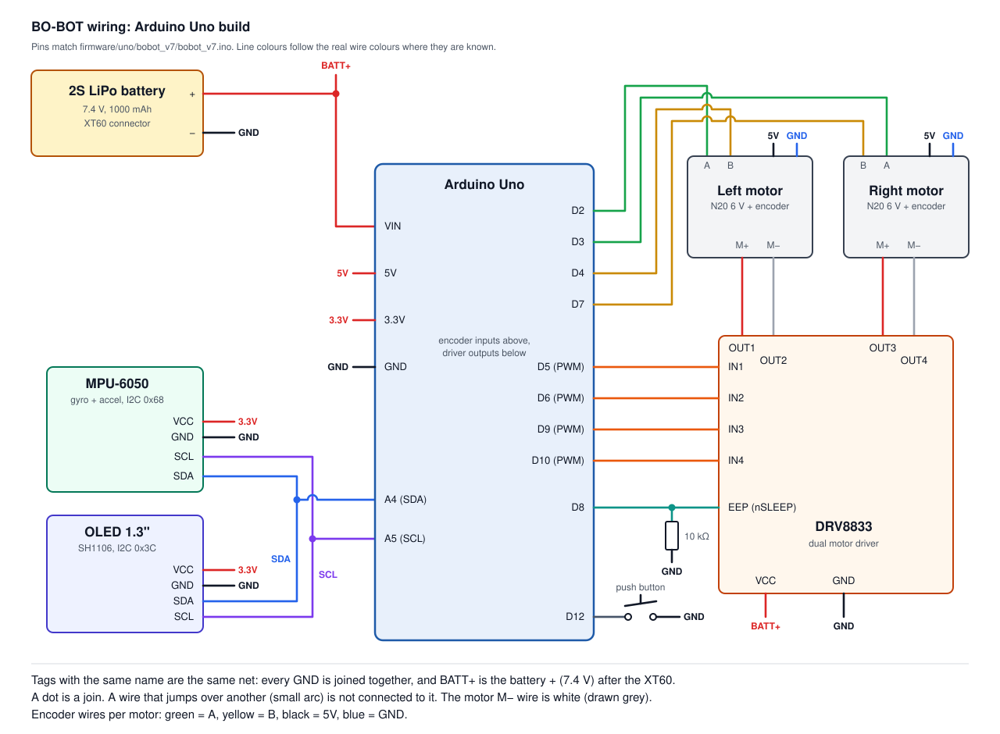
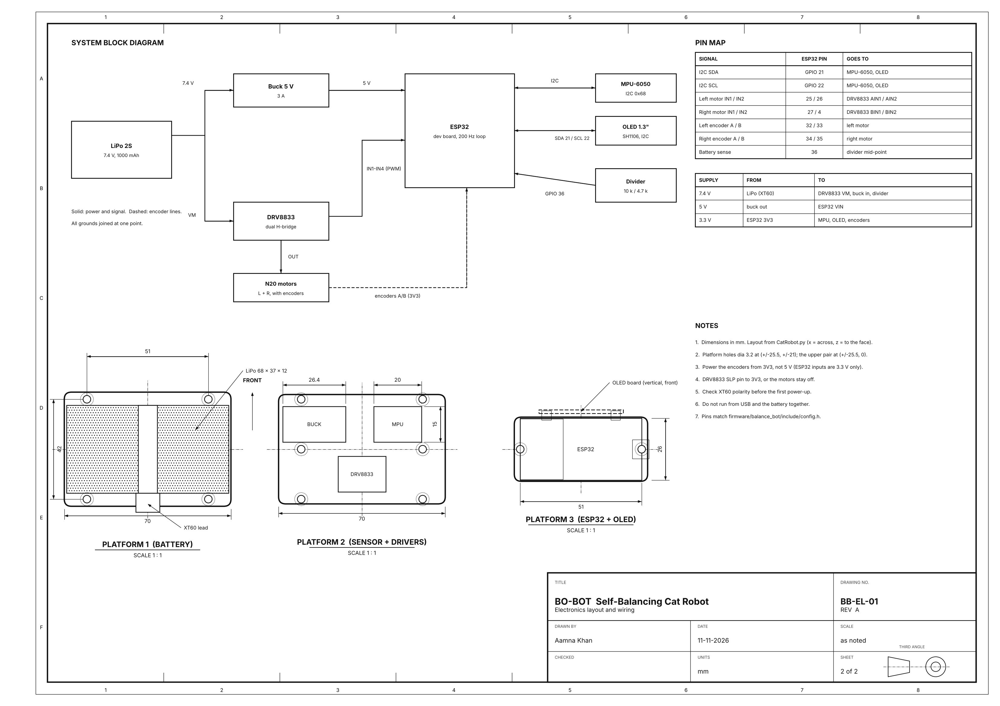
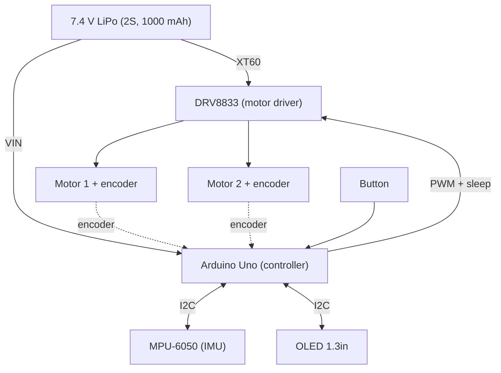
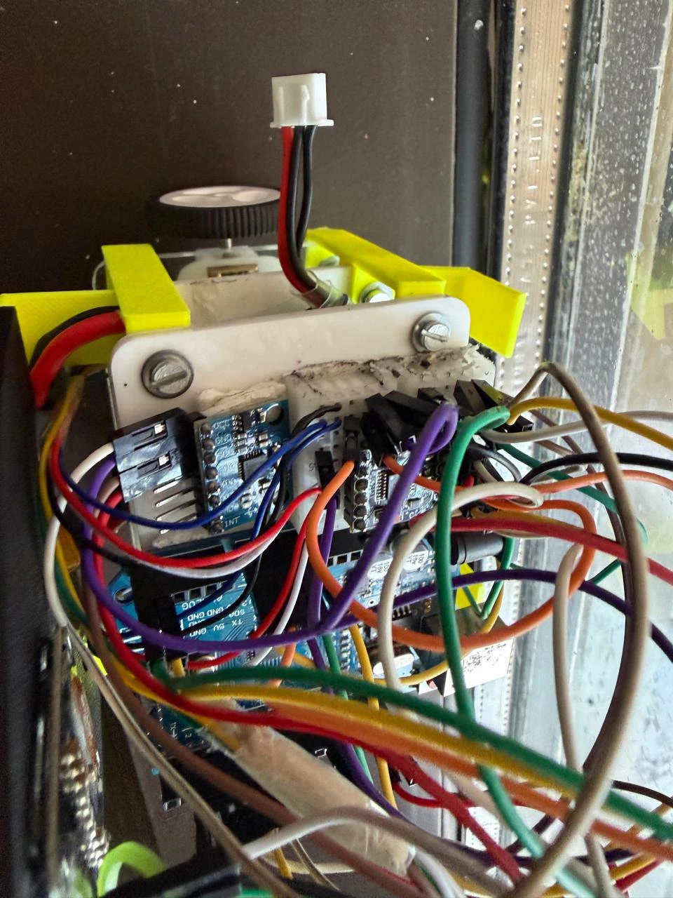
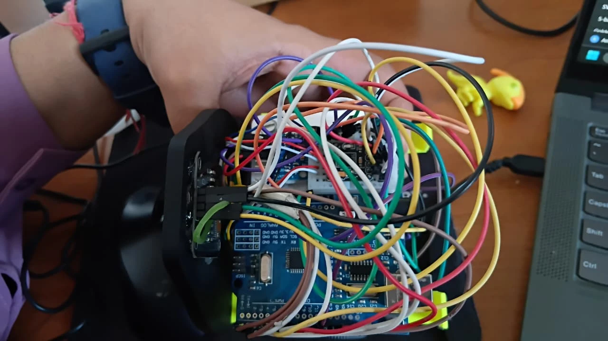
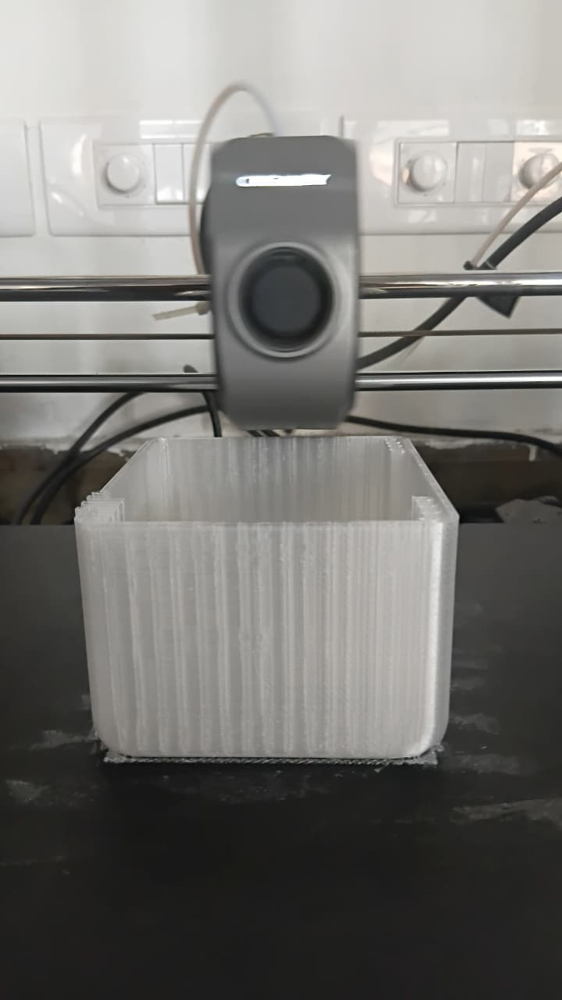

<div align="center">


<br>

**A two-wheeled, self-balancing robot with a cat-shaped casing and an animated OLED face.**<br>
Mechanical design, electronics, firmware, simulation and documentation, all in one place.

<br>

**[▶ Try the live simulator](https://aamna-builds.github.io/Bo-Bot/)**

[](https://github.com/aamna-builds/Bo-Bot/actions/workflows/ci.yml)


[About](#about) ·
[The robot](#the-robot) ·
[Wiring](#wiring) ·
[Design](#design) ·
[Specifications](#specifications) ·
[Simulation](#simulation) ·
[Architecture](#system-architecture) ·
[Repository](#repository-structure) ·
[Roadmap](#roadmap) ·
[Credits](#credits-and-licence)

</div>

---

## About

BO-BOT is an **inverted-pendulum robot**: it stands upright on two wheels and keeps its balance by continuously
measuring its tilt and driving the wheels to correct it. The body is a compact cat-shaped casing, first built as a
low-cost **thermocol prototype**, with a small OLED screen that shows a fixed pair of eyes and an animated mouth
(happy, talking, surprised, sad).

The project covers the full engineering workflow:

- **Mechanical:** parametric CAD, layered chassis, casing design and build
- **Electronics:** power distribution, motor driving, sensing and wiring
- **Control:** balance controller, tuned with simulation before running on hardware
- **Software:** Arduino Uno firmware with a 16-face animated OLED (an ESP32 version was written first)
- **Documentation:** bill of materials, wiring, build photos and videos

## The robot

<p align="center">
  
  
</p>

The built robot runs on an **Arduino Uno** with an MPU-6050, a DRV8833 driver and two N20 encoder motors. Acrylic plates are held by
3D-printed stands, the LiPo sits low between the plates, and a printed faceplate frames the 1.3" OLED face.

- **Firmware:** [`firmware/uno/bobot_v7`](firmware/uno/bobot_v7/bobot_v7.ino): cascade speed and angle control at 200 Hz,
  keep-straight from the encoders, a six-step setup wizard, settings in EEPROM, a stop / recalibrate button, and **16 animated faces**
  drawn without a screen buffer. Details in [`firmware/uno/README.md`](firmware/uno/README.md).
- **Videos:** [robot test](media/videos/robot-test.mp4) (the faces reacting as the robot is handled) and a [print time-lapse](media/videos/printing-timelapse.mp4).
  More photos in [`media/`](media/).

## Wiring

<p align="center">
  <a href="wiring/uno-wiring-diagram.svg"></a>
</p>

Pin map, motor wire colours and power notes: [`wiring/README.md`](wiring/README.md).

## Design

The design is a three-platform chassis inside an egg-shaped cat shell. The battery sits low to keep the centre of mass
close to the axle, drivers and sensors sit on the middle platform, and the ESP32 and OLED face sit at the top.

**Concept sketches:** early ideas for the outer layer, internal structure, LED face expressions and alternative looks.

<p align="center">
  
</p>

**Engineering drawings (A3, third angle), as built:** the sizes come from the files that made the parts (the laser-cut base plate
script and the OpenSCAD clamp and spacer files in [`cad/`](cad/)). Click a sheet for full size.

<p align="center">
  <a href="docs/drawings/sheet1-general-arrangement.png"></a><br>
  <sub>Sheet 1: front and side views of the plate stack, laser-cut base plate, motor clamp section, parts list.</sub>
</p>

<p align="center">
  <a href="docs/drawings/sheet2-electronics.png"></a><br>
  <sub>Sheet 2: system block diagram, Uno pin map, supplies, motor wire colours and the drive module plan.</sub>
</p>

The sheets are drawn by [`docs/drawings/draw_sheets.py`](docs/drawings/draw_sheets.py); change a number there and run it to redraw them.
The drawings of the first plan (ESP32 inside a 3D-printed cat shell) are kept in [`docs/drawings/archive-esp32-cat-shell/`](docs/drawings/archive-esp32-cat-shell/),
and the first picture-style design sheets (0.96" display, thermocol casing) in [`docs/images/archive/`](docs/images/archive/).

## Simulation

**[▶ Open the live simulator](https://aamna-builds.github.io/Bo-Bot/)** (any modern browser, nothing to install; it also works offline by
opening [`simulation/web/index.html`](simulation/web/index.html)).

A 3D bench model of the robot running the **same control law as the ESP32 firmware** (cascaded speed and angle loops at 200 Hz), with the
motors, gearbox backlash, battery, MPU-6050 and encoders modelled from datasheet values.

- **Drive and push it:** arrow keys or the on-screen pad to drive and turn, `X` / `Z` to shove it, `R` to pick it up and set it back down.
- **Tune it live:** sliders for every firmware gain (kp, kd, ki, kp_v, ki_v, trim, ...) in the firmware's own units, plus a "tuned defaults" reset.
- **Break it on purpose:** change backlash, move the MPU to another deck, add tilt error or extra weight, or run the battery down to 15 %.
- **Look inside:** toggle the cat shell and an X-ray view; the OLED face reacts to what the robot is doing.
- **Read the traces:** live pitch, motor PWM and speed plots, three camera modes, and a record button that saves a video.
- **Light or dark mode:** the toggle is in the top corner.

Details and the offline video recorder are in [`simulation/README.md`](simulation/README.md). The maths behind it is in
[`docs/equations.md`](docs/equations.md) and [`simulink/`](simulink/).

<p align="center">
  <br>
  <sub>Scripted demo: balancing, driving, turning and recovering from pushes.
  <a href="media/videos/simulation-demo.mp4">Full video (MP4)</a></sub>
</p>

## Specifications

| | |
|---|---|
| **Wheels** | 34 mm diameter, 6.5 mm wide, 101.5 mm track on the laser-cut base plate |
| **Base plate** | 89 x 62 mm laser-cut acrylic |
| **Controller** | Arduino Uno (ESP32 in the first plan) |
| **Motion sensing** | MPU-6050 (accelerometer + gyroscope, I2C) |
| **Actuation** | 2 x N20 geared motors with encoders, driven by a DRV8833 |
| **Display** | 1.3" OLED, SH1106 (I2C), fixed eyes with an animated mouth |
| **Power** | 2S 1000 mAh LiPo (7.4 V), XT60, to the driver and the Uno VIN |
| **Body** | Acrylic plates, 3D-printed stands, motor clamps and TPU faceplate (a thermocol casing was the first prototype) |
| **Control loop** | 200 Hz, cascade PD (speed / position outer loop, tilt inner loop) plus keep-straight |

## System architecture



**Control idea:** the MPU-6050 gives the tilt rate and angle, a complementary filter combines the gyroscope and
accelerometer, and a PD loop turns the tilt error into motor commands 200 times per second. An outer loop uses the wheel
encoders to lean the robot against drift, and the encoder difference keeps it driving straight.

## Repository structure

```
BO-BOT/
├── cad/            Fusion 360 parts, G-code, laser-cut plate, STLs
├── firmware/       Arduino Uno firmware (uno/) and the first ESP32 version
├── simulation/     Web and Python simulators, tuning results
├── simulink/       MATLAB / Simulink model, equations, graphs
├── hardware/       Mechanical build notes (casing, assembly)
├── electronics/    Power design, schematics, layouts
├── wiring/         Wiring diagrams and pin map
├── components/     Bill of materials and datasheets
├── media/          Photos and videos
└── docs/           Drawings, equations, OLED face previews, project log
```

Each folder has its own README describing what belongs there.

## Roadmap

| Area | Task | Status |
|---|---|---|
| CAD | Parametric Fusion 360 model of the robot | Done |
| CAD | Printed parts (plate stands, motor clamps, faceplate, face stand) and laser-cut base plate | Done, files in [`cad/`](cad/) |
| Simulation | Web simulator with live gain tuning and video recording | Done |
| Simulation | Python physics simulator with gain tuner | Done |
| Maths | Linear model, stability analysis and graphs ([equations](docs/equations.md), [`simulink/`](simulink/)) | Done in Python; MATLAB analysis run and checked (R2025b); Simulink model built and run, results in [`simulink/`](simulink/) |
| Electronics | Components, wiring and pin map | Done (Arduino Uno build), see [`wiring/`](wiring/) |
| Hardware | Components delivery | Parts arrived 14 Nov (photos in [`components/`](components/)) |
| Hardware | Chassis, wiring and faceplate | Built |
| Firmware | Balance controller, encoders, setup wizard (Arduino Uno) | v7 on the robot, tuning |
| Firmware | OLED faces | 16 faces on the robot |
| Firmware | Battery voltage monitoring on the Uno | Planned |
| Simulation | Compare the simulator with the real robot | Planned |
| Media | Build photos and test videos | Added, see [`media/`](media/) |
Detailed progress is tracked in [`docs/project-log.md`](docs/project-log.md).

## Components

The full parts list with sizes and sources is in [`components/`](components/).

## Gallery

| | |
|---|---|
|  |  |
| MPU-6050 and DRV8833 on the mini breadboard | Wiring from above |
|  |  |
| Printing the front faceplate v4 in TPU | 3D printing a body part |
|  |  |
| The printed shell (front faceplate v4, TPU) | The printed shell from the other side |

<p align="center"><a href="media/videos/robot-test.mp4"></a><br><sub>Robot test: the OLED faces reacting as the robot is handled. Click to play.</sub></p>

Print time-lapse: [`printing-timelapse.mp4`](media/videos/printing-timelapse.mp4).
Parts photos are in [`components/`](components/), simulator videos in [`media/videos/`](media/videos/).

## Credits and licence

BO-BOT is designed and built by **Aamna Khan** ([@aamna-builds](https://github.com/aamna-builds)).
Third-party libraries and tools used by the project are credited in [`CREDITS.md`](CREDITS.md).

© 2026 Aamna Khan. **All rights reserved.** See [`LICENSE`](LICENSE).
