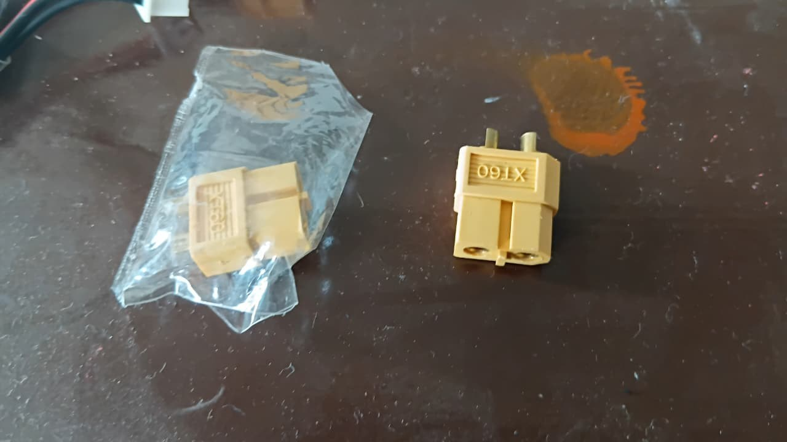
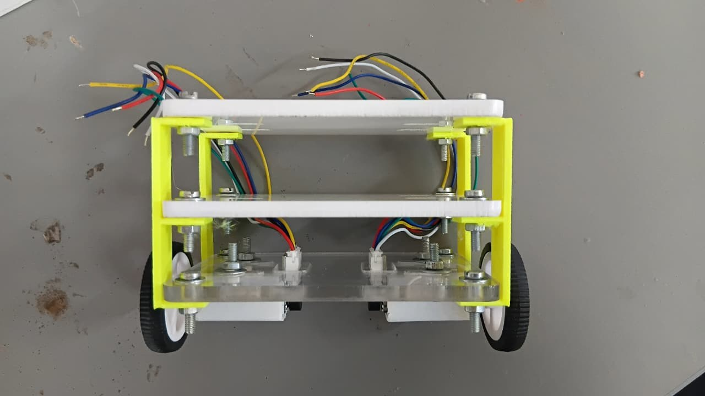

# Components / Bill of Materials

## Purchased parts

| # | Item | Qty | Use | Size |
|---|---|---|---|---|
| 1 | GA12-N20 6 V 300 RPM micro DC reducer motor with encoder | 2 | Drive wheels and speed feedback | 10 x 12 mm |
| 2 | White wheel tyre for N20 motor | 2 | Wheels | 34 mm dia |
| 3 | 1.3" I2C 4-pin OLED, blue (SH1106) | 1 | Robot face | 35.4 x 33.5 mm board |
| 4 | Compact balance charger, 2S-3S (IMAX B3 AC Pro) | 1 | Charging the LiPo | |
| 5 | DRV8833 two-way motor driver module | 1 | Drives both motors | 20 x 15 mm |
| 6 | MPU-6050 gyro + accelerometer breakout | 1 | Tilt sensing | 20 x 15 mm |
| 7 | DC-DC buck module, 6-24 V to 5 V, 3 A | 1 | 5 V supply for the ESP32 (first plan; the Uno build runs from VIN) | 26.4 x 15 mm |
| 8 | XT60 connector, male + female | 1 set | Battery connector / on-off | |
| 9 | 7.4 V 2S 1000 mAh 35C/70C LiPo battery | 1 | Main power | 68 x 37 x 12 mm |
| 10 | Jumper wires | 1 set | Signal wiring | |

**Already available:** Arduino Uno (the controller on the robot), ESP32 DevKit (first plan, not used), USB cable, push button, 10 kΩ resistor, mini breadboard, other small parts.

**Total cost (all of the above, taxes and shipping included): Rs 4,058.78**

> **Display size:** the CAD model uses the **1.3" SH1106** (board about 35.4 x 33.5 mm, active area 29.42 x 14.7 mm,
> taken from seller listings). The older design sheets in `docs/images/` still show a 0.96" display. Measure the real
> board with calipers when it arrives and update the CAD if it differs.

## Build materials (not in the purchase list above)

| Item | Qty | Notes |
|---|---|---|
| Standoffs (gold) | 4 + 2 | 18 mm and 20 mm, between platforms |
| Platforms | 3 | Spacing 20 / 20 / 18 mm |
| Thermocol sheet | | 5-8 mm, casing walls (first prototype) |
| Laser-cut acrylic base plate | 1 | See [`../cad/laser-cut/base_plate/`](../cad/laser-cut/base_plate/) |
| 3D-printed parts | | Plate stands, motor clamps, faceplate and face stand, see [`../cad/`](../cad/) |
| M3 screws and nuts | | Motor clamps and plates |

## First BOM (ESP32 plan)
The printable BOMs made for the ESP32 plan (8 and 9 Nov), with the scripts that generate them, are in
[`bom-esp32-archive/`](bom-esp32-archive/). The parts are the same apart from the controller.

## Datasheets
Put PDFs in [`datasheets/`](datasheets/).

## Photos of the parts (arrived 14 Nov 2026)

| | | |
|---|---|---|
|  |  |  |
| Wheels (34 mm) | 1.3" OLED | N20 motors with encoders |
|  |  |  |
| DRV8833 motor driver (headers not soldered yet) | MPU-6050 (headers not soldered yet) | Buck converter (USB-A output) |
|  |  |  |
| IMAX B3 Pro balance charger | XT60 connectors | 2S 7.4 V 1000 mAh 35C LiPo (XT60 + balance lead) |

## Build progress

| | |
|---|---|
|  |  |
| Chassis assembled (acrylic plates, 3D-printed brackets, motors and wheels) | First motor bench test with an Arduino Uno on USB power |
