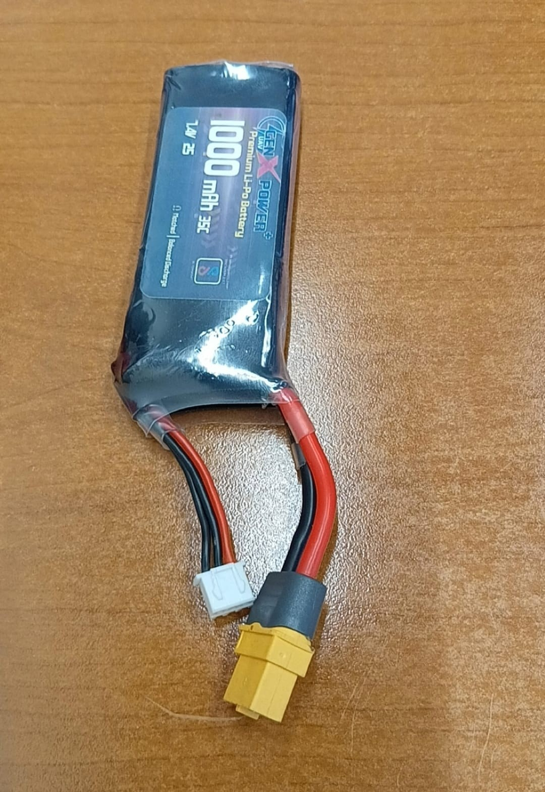

# Components / Bill of Materials

## Final parts list (what is on the robot)

### Electronics

| # | Part | Qty | Job on the robot | Size |
|---|---|---|---|---|
| 1 | Arduino Uno | 1 | Controller: 200 Hz balance loop, OLED face, serial tuning | 68.6 x 53.4 mm |
| 2 | MPU-6050 gyro + accelerometer (GY-521) | 1 | Tilt angle and tilt rate, I2C 0x68 | 20 x 15 mm |
| 3 | DRV8833 two-way motor driver module | 1 | Drives both motors from the Uno PWM pins | 20 x 15 mm |
| 4 | GA12-N20 6 V 300 RPM geared motor with encoder | 2 | Drive wheels; encoders give speed, distance and heading | 12 x 10 mm body |
| 5 | White wheel tyre for N20 motor | 2 | Wheels | 34 mm dia, 6.5 mm wide |
| 6 | 1.3" I2C OLED, blue (SH1106) | 1 | Animated face, I2C 0x3C | 35.4 x 33.5 mm board |
| 7 | 7.4 V 2S 1000 mAh 35C LiPo | 1 | Main power, straight to the DRV8833 and the Uno VIN | 68 x 37 x 12 mm |
| 8 | XT60 connector, male + female | 1 set | Battery connector / on-off | |
| 9 | Push button (4-leg) | 1 | Stop and recalibrate (D12) | |
| 10 | 10 kΩ resistor | 1 | Keeps the DRV8833 asleep during reset (D8 to GND) | |
| 11 | Mini breadboard | 1 | Holds the MPU-6050 and DRV8833 | |
| 12 | Jumper wires | 1 set | Signal and power wiring | |

### Mechanical

| # | Part | Qty | Made by | Files |
|---|---|---|---|---|
| 13 | Base plate, acrylic, 89 x 62 mm | 1 | Laser cut | [`cad/laser-cut/base_plate/`](../cad/laser-cut/base_plate/) |
| 14 | Upper decks (battery deck, Uno deck) | 2 | | |
| 15 | Spacer pins (17 mm gap) | 8 | 3D printed, PLA | [`cad/printed-parts/spacers/`](../cad/printed-parts/spacers/) |
| 16 | Motor clamp, top + bottom | 2 | 3D printed, PLA | [`cad/printed-parts/n20_clamp/`](../cad/printed-parts/n20_clamp/) |
| 17 | Plate stand v2 (yellow) | 4 | 3D printed, PLA | [`plate_stand_v2_bobot.f3d`](../cad/printed-parts/fusion360/plate_stand_v2_bobot.f3d) |
| 18 | Front faceplate v4 with the OLED window and BO-BOT name | 1 | 3D printed, TPU | [`front_faceplate_v4_bobot.f3d`](../cad/printed-parts/fusion360/front_faceplate_v4_bobot.f3d) |
| 19 | Face stand v2 | 1 | 3D printed | [`face_stand_v2_bobot.f3d`](../cad/printed-parts/fusion360/face_stand_v2_bobot.f3d) |
| 20 | M3 x 20 screw + M3 nut | 4 + 4 | Bought | Motor clamps |

### Tools and support (not on the robot)

| Part | Use |
|---|---|
| IMAX B3 AC Pro balance charger, 2S-3S | Charging the LiPo |
| USB cable | Uploading and Serial Monitor tuning |

### Bought but not used in the final build

| Part | Why |
|---|---|
| ESP32 DevKit | First plan; the build moved to the Arduino Uno on 16 Nov |
| DC-DC buck module, 6-24 V to 5 V, 3 A | Was the 5 V supply for the ESP32; the Uno runs from VIN |
| Thermocol sheet | First casing prototype, replaced by printed parts |

**Total cost of the purchased parts (taxes and shipping included): Rs 4,058.78.** The printable BOMs from the first plan (8 and 9 Nov)
are in [`bom-esp32-archive/`](bom-esp32-archive/).
## Datasheets
Put PDFs in [`datasheets/`](datasheets/).

## Photos of the parts (arrived 14 Nov 2026)

| | | |
|---|---|---|
|  |  |  |
| Wheels (34 mm) | 1.3" OLED | N20 motors with encoders |
|  |  |  |
| DRV8833 motor driver (headers not soldered yet) | MPU-6050 (headers not soldered yet) | Buck converter (bought, not used in the final build) |
|  |  |  |
| IMAX B3 Pro balance charger | XT60 connectors | 2S 7.4 V 1000 mAh 35C LiPo (XT60 + balance lead) |

## Build progress

| | |
|---|---|
|  |  |
| Chassis assembled (acrylic plates, 3D-printed brackets, motors and wheels) | First motor bench test with an Arduino Uno on USB power |
