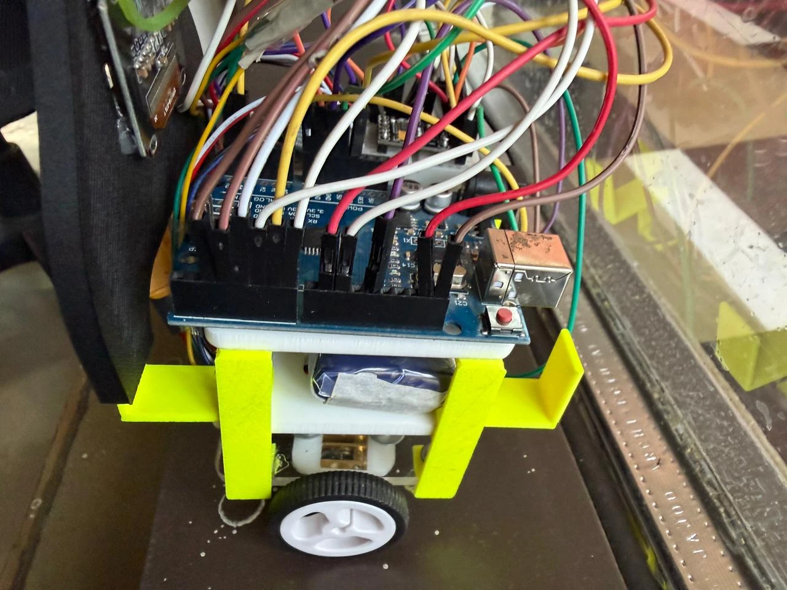
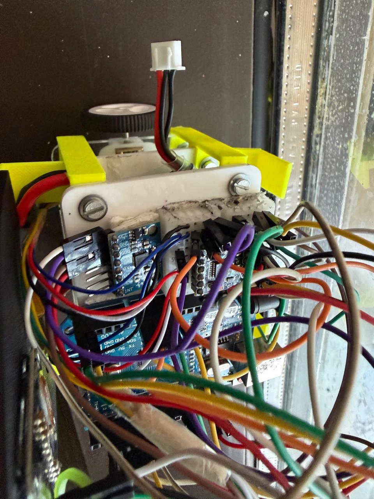
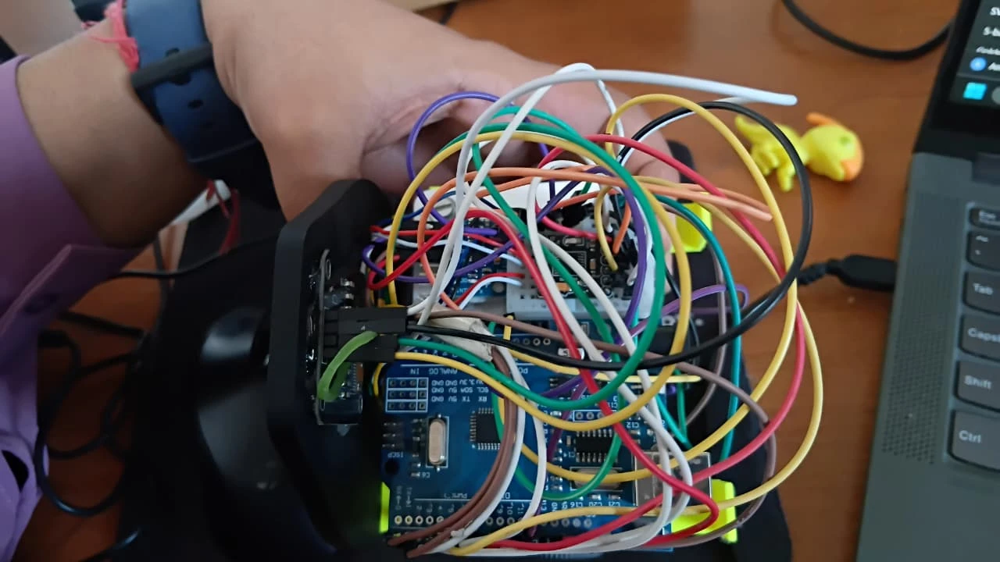
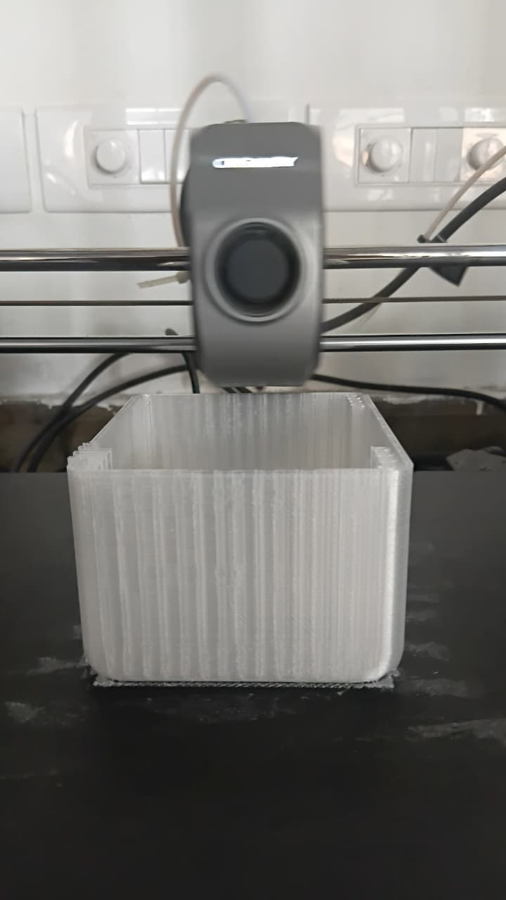

# Media

- `images/`: photos, CAD renders, screenshots
- `videos/`: build and demo clips

Keep individual files under ~50 MB. For longer videos, upload them elsewhere (for example YouTube or Drive) and add the link to the table below.

| Date | Title | File / link |
|---|---|---|
| 2026-11-09 | Simulation demo (balancing, driving, pushes, X-ray, fall) | [`videos/simulation-demo.mp4`](videos/simulation-demo.mp4) |
| 2026-11-09 | Simulator 3D view with the cat shell | [`images/simulator-3d-view.png`](images/simulator-3d-view.png) |
| 2026-11-14 | Parts as they arrived | [`images/parts/`](images/parts/) |
| 2026-11-20 | Robot test: the OLED faces reacting while the robot is handled (21 s, no sound) | [`videos/robot-test.mp4`](videos/robot-test.mp4) |
| 2026-11-20 | Time-lapse of a body part printing on the Creality printer (no sound) | [`videos/printing-timelapse.mp4`](videos/printing-timelapse.mp4) |

## Robot photos

| | |
|---|---|
|  |  |
| Front: TPU faceplate with the OLED window, XT60 battery leads | Side: Arduino Uno on top, LiPo between the plates, yellow plate stands |
|  |  |
| Top: MPU-6050 and DRV8833 on the mini breadboard, motor and encoder leads | Wiring, seen from above |
|  |  |
| Printing the front faceplate v4 in TPU | 3D printing a body part |
|  |  |
| The printed shell (front_faceplate_v4, TPU): window and wheel-arch cut-out | The printed shell from the other side |
