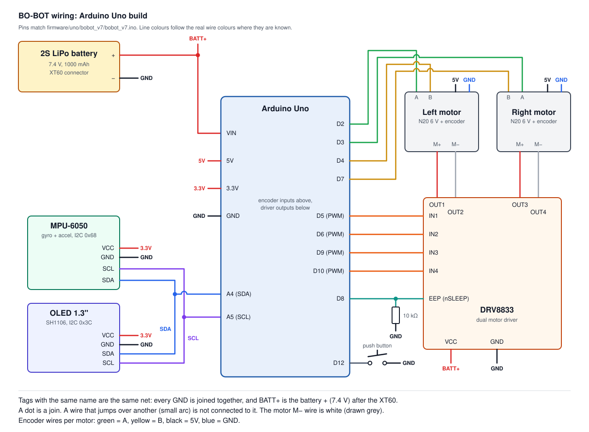
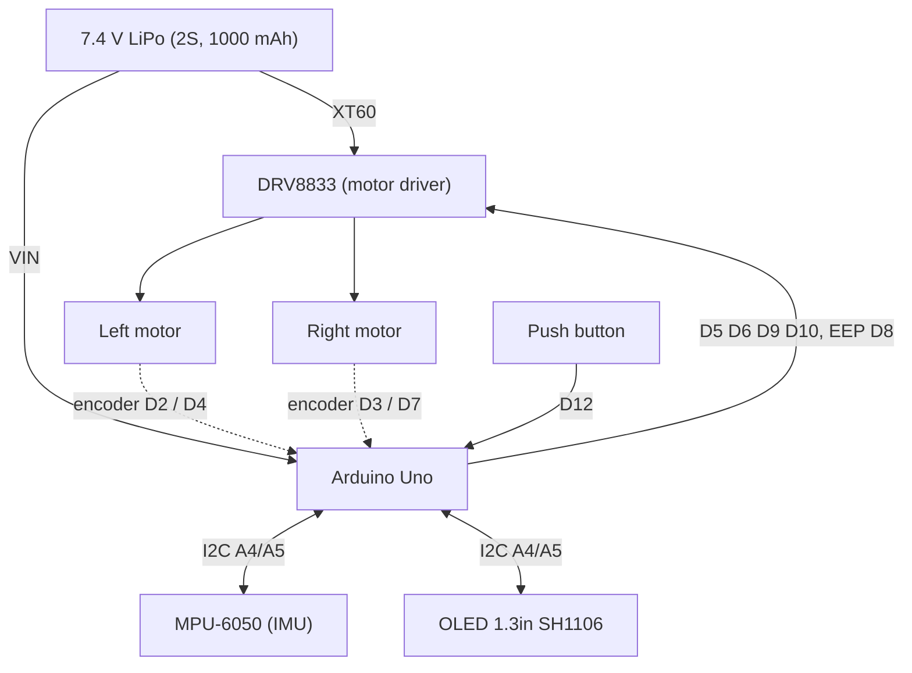
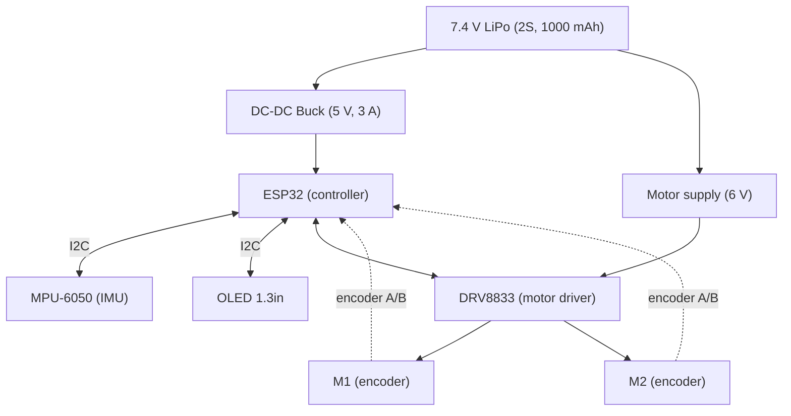
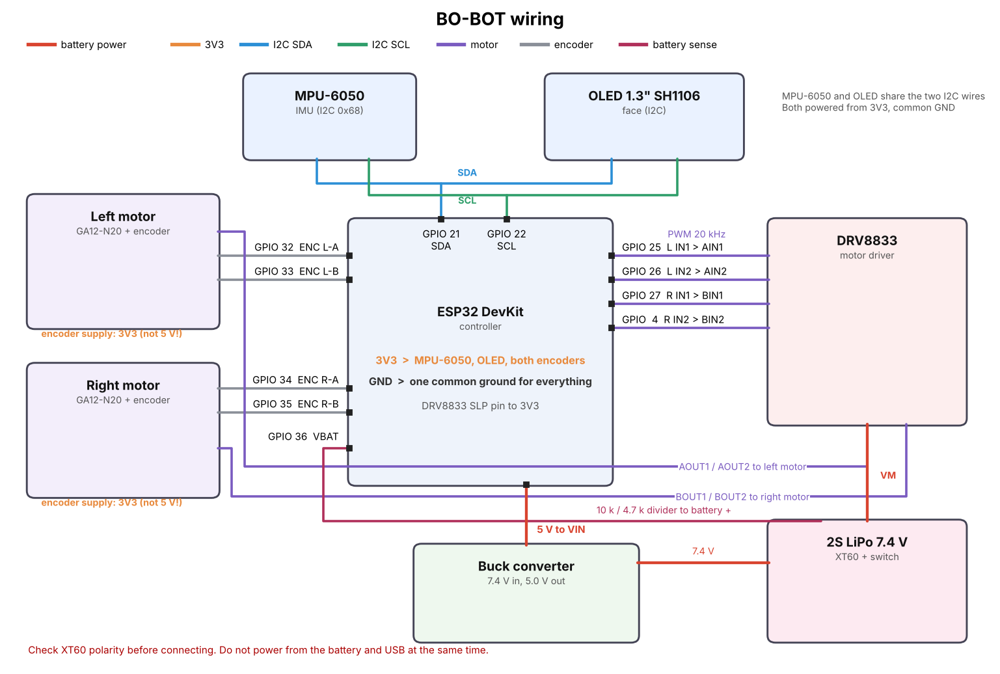

# Wiring

## Arduino Uno build (what is on the robot)

These connections match [`firmware/uno/bobot_v7/bobot_v7.ino`](../firmware/uno/bobot_v7/bobot_v7.ino). If you move a wire, change the
pin in the sketch too.

### Pin map

| Uno pin | Connects to | Notes |
|---|---|---|
| D2 | Left encoder **green** (A) | interrupt, rising edge |
| D3 | Right encoder **green** (A) | interrupt, rising edge |
| D4 | Left encoder **yellow** (B) | read in the interrupt to get the direction |
| D7 | Right encoder **yellow** (B) | read in the interrupt to get the direction |
| D5 | DRV8833 IN1 | left motor, PWM |
| D6 | DRV8833 IN2 | left motor, PWM |
| D9 | DRV8833 IN3 | right motor, PWM (timer 1 set to about 976 Hz) |
| D10 | DRV8833 IN4 | right motor, PWM |
| D8 | DRV8833 EEP (nSLEEP) | 10 kΩ from D8 to GND keeps the driver asleep during reset and upload |
| D12 | Push button, other leg to GND | internal pull-up; use the diagonal legs of a 4-leg button |
| A4 (SDA) | MPU-6050 SDA and OLED SDA | shared I2C bus, 400 kHz |
| A5 (SCL) | MPU-6050 SCL and OLED SCL | shared I2C bus |
| 3.3V | MPU-6050 VCC, OLED VCC | |
| 5V | Both encoder supplies (black wires) | |
| GND | Encoder GND (blue), MPU, OLED, DRV8833 GND, button, battery − | one common ground |
| VIN | Battery + | |
| D0 / D1 | USB serial | Serial Monitor, 115200 baud |

I2C addresses: MPU-6050 `0x68`, OLED `0x3C` (the firmware also tries `0x3D`).

### Motors

| Wire | Left motor | Right motor |
|---|---|---|
| Red (motor +) | DRV8833 OUT1 | DRV8833 OUT3 |
| White (motor −) | DRV8833 OUT2 | DRV8833 OUT4 |
| Green (encoder A) | D2 | D3 |
| Yellow (encoder B) | D4 | D7 |
| Black (encoder power) | 5V | 5V |
| Blue (encoder ground) | GND | GND |

The right motor is mounted mirror-image, so it turns the other way for the same command. The setup wizard (`check`) finds the direction
of each motor and encoder and saves it, so the motor wires do not need to be swapped.

### Power

| From | To |
|---|---|
| Battery + (through the XT60) | DRV8833 VCC and Uno VIN |
| Battery − | Common GND |
| Uno 5V | Encoders |
| Uno 3.3V | MPU-6050 and OLED |

### Notes

- **The MPU-6050 lies flat, chip up, near the wheel axle.** Its Z accelerometer is dead, so the firmware measures tilt from the forward
  axis only.
- **Check the XT60 polarity** before connecting the battery.
- **Upload with the battery unplugged** or with the robot lying down; the driver stays asleep until balancing starts, but it is safer.
- There is no battery voltage sensing on the Uno build. Charge the LiPo with the balance charger and do not run it flat
  (below about 6.6 V for the pack).

---

## ESP32 design (earlier plan, not built)

The first plan used an ESP32 with a 5 V buck converter. The robot was built with the Arduino Uno above instead. The ESP32 wiring is
kept here because the ESP32 firmware in [`../firmware/balance_bot/`](../firmware/balance_bot/) uses it.

The picture is drawn from the pin map below by [`draw_wiring.py`](draw_wiring.py).

### Pin map (ESP32 DevKit)
These pins match [`firmware/balance_bot/include/config.h`](../firmware/balance_bot/include/config.h).

| Signal | ESP32 pin | Connects to |
|---|---|---|
| I2C SDA | GPIO 21 | MPU-6050 SDA and OLED SDA |
| I2C SCL | GPIO 22 | MPU-6050 SCL and OLED SCL |
| Left motor IN1 / IN2 | GPIO 25 / 26 | DRV8833 AIN1 / AIN2 |
| Right motor IN1 / IN2 | GPIO 27 / 4 | DRV8833 BIN1 / BIN2 |
| Left encoder A / B | GPIO 32 / 33 | Left motor encoder outputs |
| Right encoder A / B | GPIO 34 / 35 | Right motor encoder outputs |
| Battery voltage sense | GPIO 36 | Midpoint of a 10 k / 4.7 k divider across the battery |

| From | To |
|---|---|
| Battery + (through the XT60 / switch) | DRV8833 VM, buck converter input, top of the battery divider |
| Buck converter 5 V output | ESP32 VIN (5 V pin) |
| ESP32 3V3 | MPU-6050 VCC, OLED VCC, both encoder supply pins |
| All grounds | One common ground (battery, buck, ESP32, DRV8833, sensors, encoders) |
| Divider bottom resistor | GND |

On the ESP32 the encoders must run from 3V3, because its inputs must not see more than 3.3 V. The Uno has 5 V inputs, so the Uno
build powers them from 5V.
